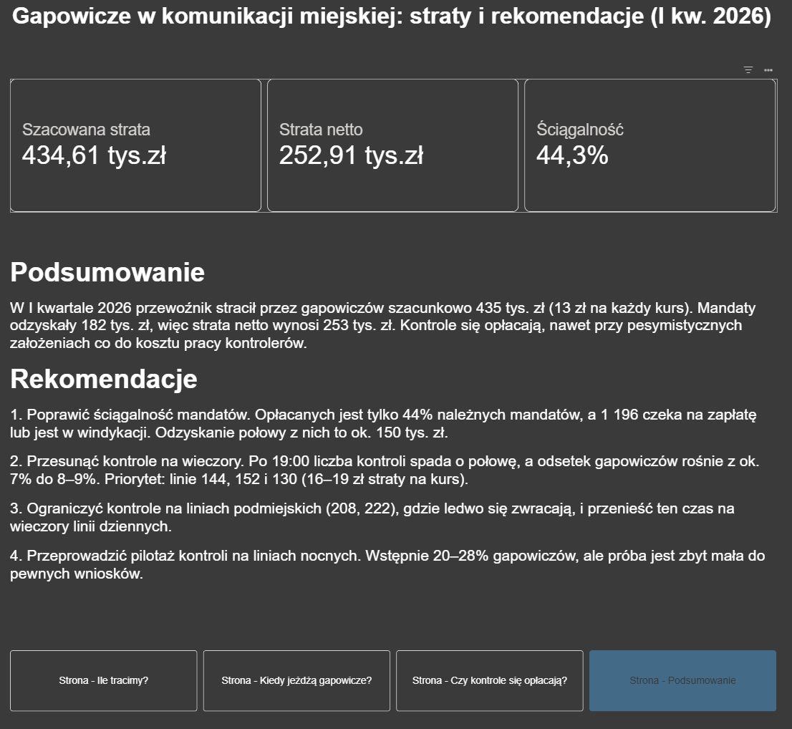
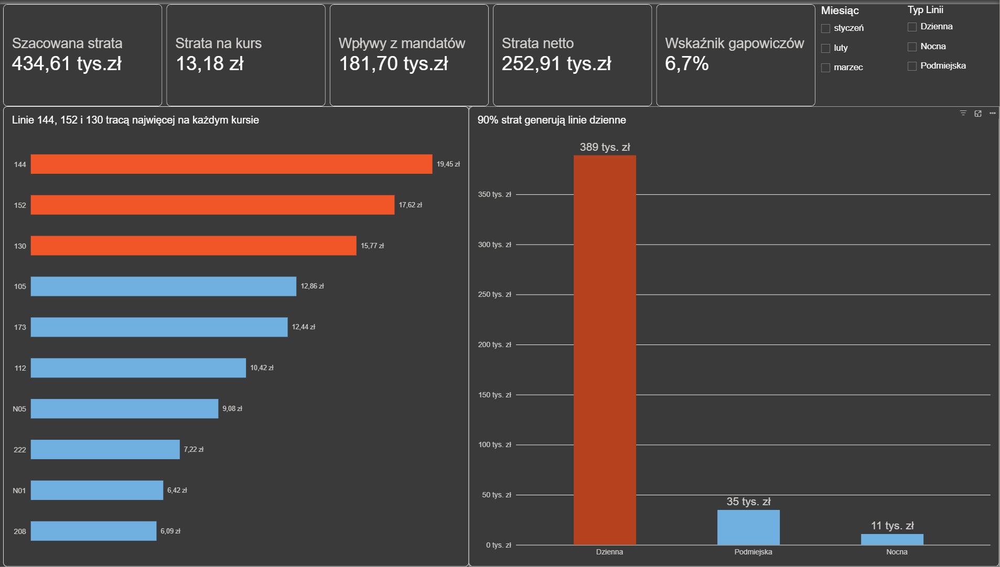
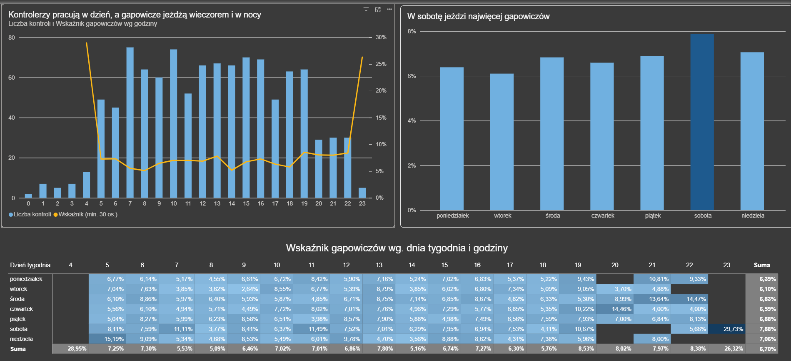
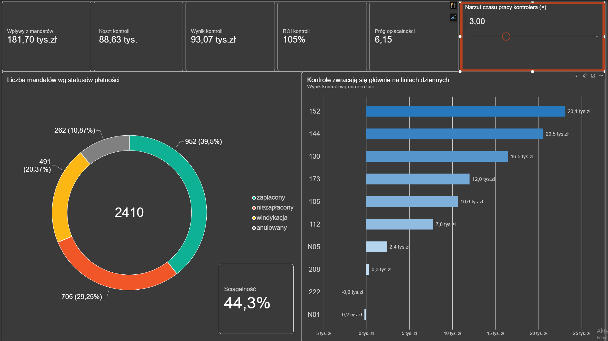

# Ile tracimy przez gapowiczów? Analiza strat przewoźnika miejskiego w Power BI

Projekt analityczny end-to-end: od surowych, „brudnych” danych w CSV, przez czyszczenie w Power Query i model danych z miarami DAX, po interaktywny raport z rekomendacjami biznesowymi.

> **Uwaga:** projekt bazuje na **danych symulowanych** (fikcyjny przewoźnik, 10 linii autobusowych, I kwartał 2026). Dane celowo zawierają typowe problemy jakościowe, żeby odwzorować realną pracę analityka.



---

## Pytania biznesowe

1. Ile średnio traci jeden kurs autobusu przez gapowiczów i które linie tracą najwięcej?
2. Kiedy jeździ najwięcej gapowiczów: o jakich godzinach, w jakie dni, na jakich typach linii?
3. Ile pieniędzy faktycznie odzyskujemy z mandatów?
4. Czy kontrole biletów się opłacają i gdzie warto kontrolować częściej?

## Kluczowe wnioski

| Wskaźnik | Wartość |
|---|---|
| Szacowana strata (I kw.) | **435 tys. zł** |
| Strata na jeden kurs | **13,18 zł** |
| Wpływy z mandatów | 182 tys. zł |
| Strata netto | **253 tys. zł** |
| Ściągalność mandatów | 44,3% |
| Średni odsetek gapowiczów | 6,7% |

**Rekomendacje (od największego wpływu finansowego):**

1. **Poprawić ściągalność mandatów.** Opłacanych jest tylko 44% należnych mandatów, a 1 196 pozostaje niezapłaconych lub w windykacji. Odzyskanie połowy z nich to ok. 150 tys. zł.
2. **Przesunąć kontrole na wieczory.** Po 19:00 liczba kontroli spada o połowę, a odsetek gapowiczów rośnie z ok. 7% do 8–9%. Priorytet mają linie 144, 152 i 130, które tracą 16–19 zł na kurs.
3. **Ograniczyć kontrole na liniach podmiejskich.** Przy realistycznym koszcie pracy kontrolerów ledwo się tam zwracają.
4. **Przeprowadzić pilotaż kontroli na liniach nocnych.** Wstępnie 20–28% gapowiczów, ale próba jest zbyt mała do pewnych wniosków, a linie nocne odpowiadają tylko za ok. 3% strat.

---

## Raport

| Strona | Pytanie |
|---|---|
|  | **Ile tracimy?** KPI, strata na kurs wg linii, strata wg typu linii |
|  | **Kiedy jeżdżą gapowicze?** Kontrole a wskaźnik wg godziny, dni tygodnia, mapa ciepła dzień × godzina |
|  | **Czy kontrole się opłacają?** Ściągalność, koszt i ROI kontroli, analiza wrażliwości (parametr What-if) |

---

## Proces (CRISP-DM)

### 1. Dane
| Tabela | Opis | Wiersze |
|---|---|---|
| `linie` | słownik linii (typ, trasa, długość) | 10 |
| `kursy` | każdy przejazd z liczbą pasażerów z automatycznych liczników | 32 980 |
| `kontrole` | kontrole biletów: liczba skontrolowanych i gapowiczów | 1 061 |
| `mandaty` | mandaty ze statusem płatności i kwotą wpłaty | 2 410 |

### 2. Czyszczenie danych (Power Query)
- Błędne wykrycie typu kolumny (`N01` traktowane jako liczba) zastąpiłem ręcznym ustawieniem typu tekstowego.
- Usunąłem zbędne spacje i ujednoliciłem wielkość liter w kluczach i kategoriach (np. `" 105"` → `"105"`, `"n01"` → `"N01"`).
- Usunąłem duplikaty (60 kursów, 12 kontroli).
- Ujednoliciłem 13 wariantów zapisu statusu płatności do 4 kategorii.
- Przekonwertowałem kwoty zapisane jako tekst (`"150,00 zł"`) na liczby.
- 6 kontroli z liczbą gapowiczów większą niż liczba skontrolowanych oznaczyłem jako brak danych (null), bez usuwania wierszy.
- 494 kursy bez danych z licznika uzupełniłem średnią dla tej samej linii i godziny (Group By + Merge) i oznaczyłem flagą `czy_uzupelniono`.

### 3. Model danych
Tabela kalendarza w DAX, relacje 1:* z jednokierunkowym filtrowaniem, osobna tabela parametrów i tabela miar.

```
linie ──► kursy ──► kontrole ──► mandaty
            ▲
Kalendarz ──┘
```

### 4. Wybrane miary DAX

**Szacowana strata.** Wskaźnik gapowiczów liczony osobno dla każdej linii, a nie średni dla całej sieci:
```dax
Szacowana strata =
SUMX (
    VALUES ( linie[numer_linii] ),
    [Pasażerowie] * [Wskaźnik linii] * [Cena biletu]
)
```

**Stabilny wskaźnik linii.** Niezależny od filtra daty i godziny, żeby godziny bez kontroli nie dawały zerowej straty:
```dax
Wskaźnik linii =
CALCULATE (
    [Wskaźnik gapowiczów],
    REMOVEFILTERS ( Kalendarz ),
    REMOVEFILTERS ( kursy[godzina] )
)
```

**Mianownik tylko z wiarygodnych kontroli:**
```dax
Skontrolowani =
CALCULATE (
    SUM ( kontrole[liczba_skontrolowanych] ),
    NOT ISBLANK ( kontrole[liczba_gapowiczow] )
)
```

**Ukrywanie wyników z małej próby:**
```dax
Wskaźnik (min. 30 os.) =
IF ( [Skontrolowani] >= 30, [Wskaźnik gapowiczów] )
```

### 5. Analiza wrażliwości
Koszt kontroli liczony z samego czasu w autobusie jest zaniżony, bo nie obejmuje dojazdów, oczekiwania i formalności. Dlatego dodałem **parametr What-if** (narzut czasu pracy ×1–×8). Kontrole pozostają opłacalne aż do narzutu **×6,15**, więc wniosek „kontrole się opłacają” jest odporny na błędne założenia.

---

## Założenia i ograniczenia
- Cena biletu: 4,60 zł; mandat: 250 zł (150 zł przy zapłacie w 7 dni); koszt kontrolera: 45 zł/h.
- Odsetek gapowiczów z kontroli jest ekstrapolowany na wszystkich pasażerów danej linii, przy założeniu, że kontrole są losowe.
- Wskaźniki dla linii nocnych opierają się na małej próbie (71 i 134 skontrolowane osoby), więc należy je traktować orientacyjnie.
- Wskaźnik linii nie uwzględnia zmienności w ciągu dnia (uproszczenie).

## Technologie
Power BI Desktop · Power Query (M) · DAX · Excel

## Struktura repozytorium
```
├── README.md
├── Gapowicze.pbix          # raport Power BI
├── dziennik_decyzji.md     # decyzje podjęte podczas analizy
├── dane/                   # surowe pliki CSV
│   ├── linie.csv
│   ├── kursy.csv
│   ├── kontrole.csv
│   └── mandaty.csv
└── images/                 # zrzuty ekranu raportu
```

## Autor
Hubert Marszałek · [LinkedIn](https://www.linkedin.com/in/hubert-marsza%C5%82ek/) · projekt zrealizowany w ramach nauki analizy danych
